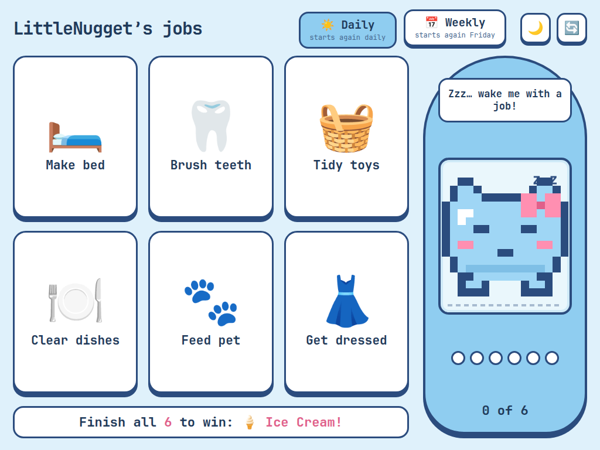
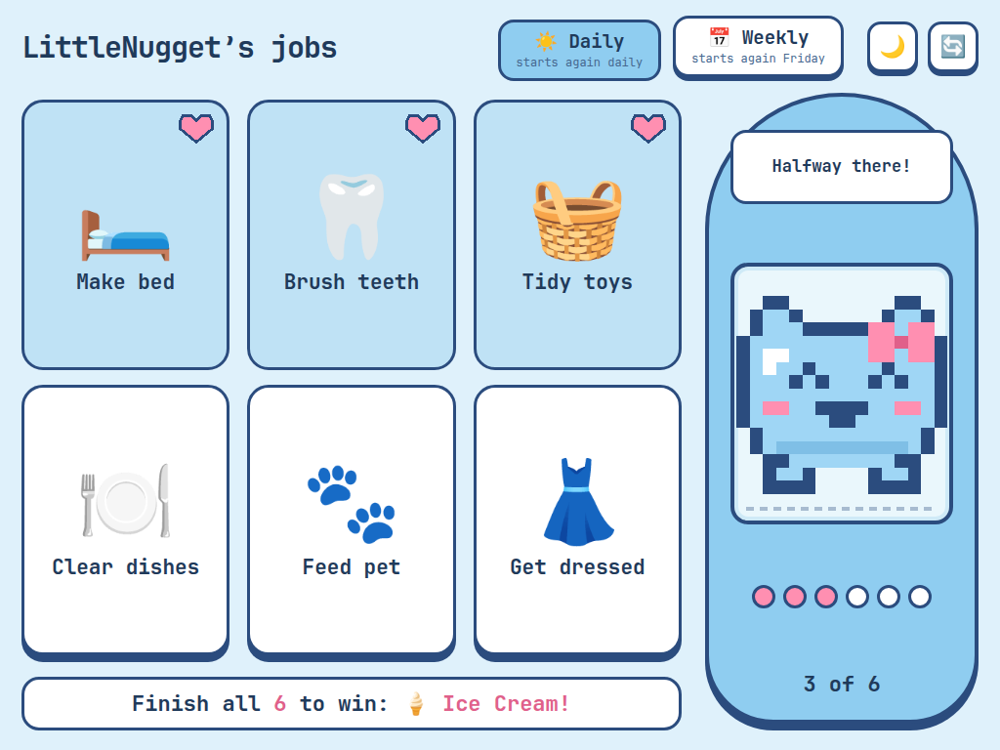
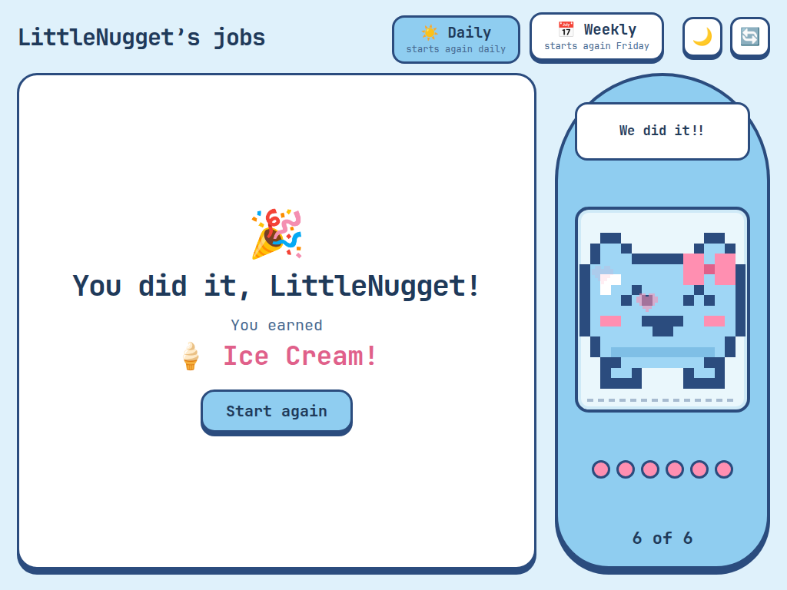
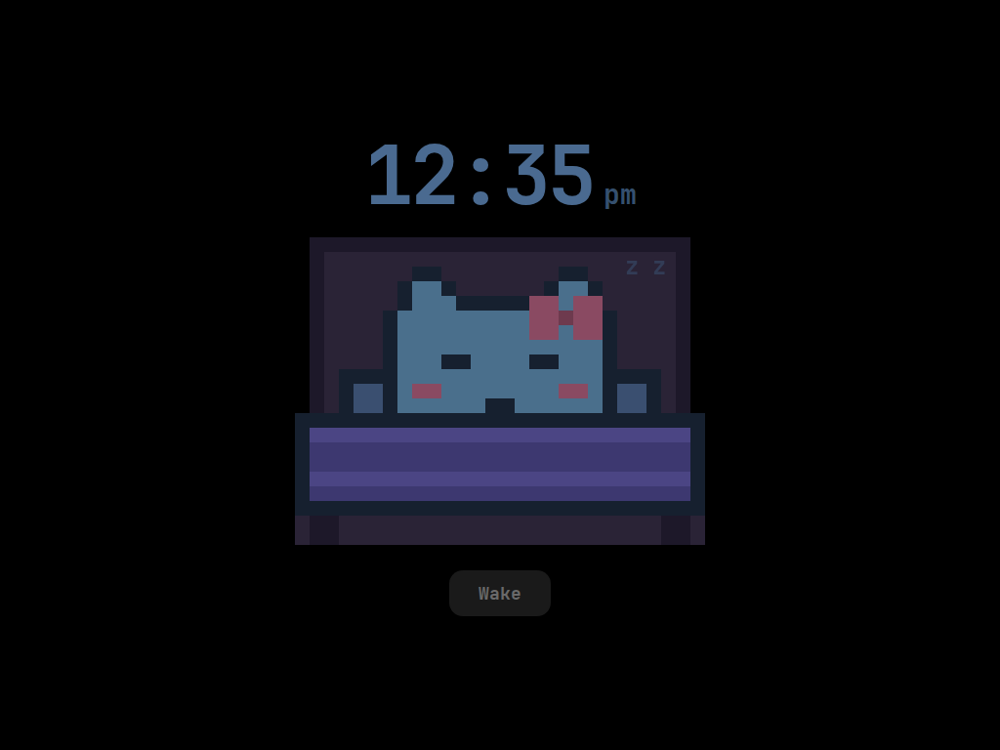
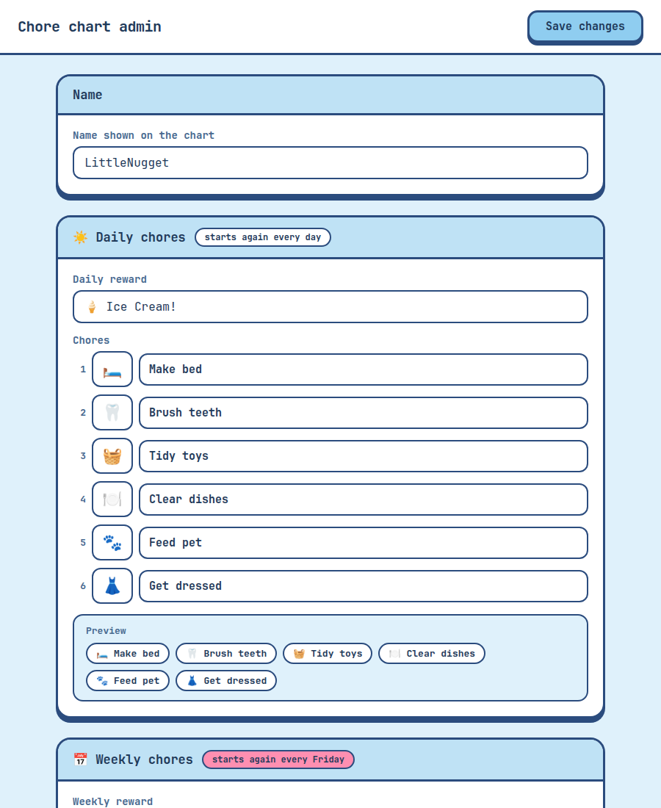

# Choreboard

A self-hosted chore reward chart for one kid, built to collect as little as possible.

Flask + Docker, served from a home server, displayed on a wall-mounted tablet. No account,
no cloud, no third party.

## What it looks like

Shown on an iPad mini in landscape. Each chore is a sticker that presses in and gets a heart stamp when
it is done. A small pixel pet in a handheld frame mirrors the day's progress: asleep at zero chores,
awake after the first, bouncing from halfway, dancing when everything is done. It cannot get sick or
die, so it never punishes a missed day. The pet is an original drawing, not a licensed character.

| Nothing done yet | Halfway | All done |
| --- | --- | --- |
|  |  |  |

The moon button turns the screen into a dark sleep screen: the pet tucked up in bed under a dim
digital clock, with a Wake button to come back.



The parent-facing admin page sets the name, rewards and chores:



The screenshots use the default config and the public handle LittleNugget.

## The design constraint

The server stores the chore **list** only. It never stores which chores are done, or when.
Completion state lives entirely in the browser's local storage on the device.

That is a deliberate trade. It means completion does not sync across devices, and clearing
browser data resets the day. In exchange, a compromise of the server reveals a list of chores
and nothing whatsoever about a child's actual behaviour.

The full reasoning, including what went wrong along the way, is in [WRITEUP.md](WRITEUP.md).

## Running it

```bash
git clone https://github.com/Moistnutmeg/choreboard.git
cd choreboard
./rebuild.sh
```

Then open `http://<host>:8090`.

`rebuild.sh` builds the image and runs the container with `/data` bind-mounted so config
survives rebuilds. Override the data location with `CHOREBOARD_DATA`:

```bash
CHOREBOARD_DATA=/srv/choreboard ./rebuild.sh
```

## Configuring

The parent-facing admin page is at `/admin`. It sets the child's display name, the daily and
weekly chore lists, and the reward text for each. Config is written to `/data/config.json`
and seeded with defaults on first run.

There is no authentication on `/admin`. It is designed for a single trusted household on a
LAN, not for the public internet. Do not expose this to the internet as-is. The write-up is
explicit about what would have to change first.

## Layout

| Path | Purpose |
| --- | --- |
| `app.py` | Flask app, config read/write, JSON API |
| `templates/chart.html` | The kid-facing chart, completion state in localStorage |
| `templates/admin.html` | Parent-facing config editor |
| `static/` | Favicon and the bundled JetBrains Mono font files |
| `docs/screenshots/` | Screenshots used in this README |
| `Dockerfile` | python:3.11-slim, Flask, port 8090, `/data` volume, copies `templates/` and `static/` |
| `rebuild.sh` | Build and restart the container |

## Licence

No licence specified for the code. Ask before reuse.

The bundled JetBrains Mono fonts in `static/fonts/` are under the SIL Open Font License 1.1 (see
`static/fonts/OFL.txt`).
